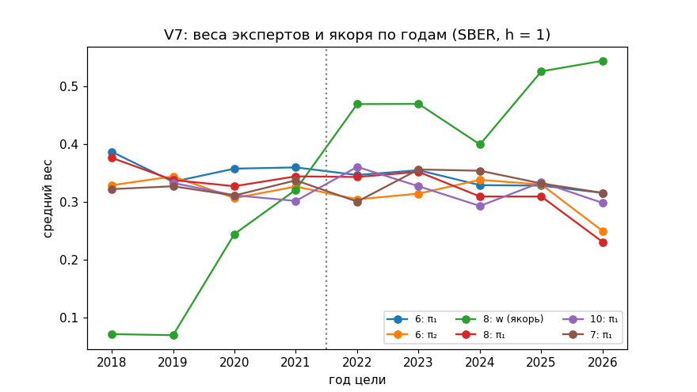

Нет: 0 из 9 посчитанных конфигураций V7 имеют на 2018–2021 90 % интервал Δ целиком ниже нуля против K2 (XGBoost), K3 (LightGBM), NTP2 и A2 одновременно; «go» 6.1 выполнено у 0 из 9; лучшая по QLIKE 2018–2021 — cfg8 (0,1595; K3 0,1636, NTP2 0,1588, A2 0,1559), лучшая по 2022–2025 — cfg8 (0,2943; K3 0,2880, NTP2 0,2892, A2 0,3170); наименьший p Холма (N = 733) у лучшей 2018–2021 против этих четырёх — 1,000; статус — улучшения не подтверждено.

DEVELOPMENT / HISTORICAL WALK-FORWARD, не независимый OOS; первая цифра — потолок; дизайн K2/K3 выбирался на SBER 2017–2021.

# HARJ_HYBRID_SBER_V7_M10_MOE_FINAL — итог программы HAR-J Hybrid V7 (Ж-232, Ж-233, Ж-235, Ж-236), SBER, h = 1

## 1. Результат: преимущество V7 над XGBoost, LightGBM, NTP2 и A2

Лучшая по QLIKE 2018–2021: **cfg8** (0,1595); лучшая по 2022–2025: **cfg8** (0,2943). Δ = QLIKE(конфигурация) − QLIKE(база) в % среднего QLIKE K1 окна: минус — конфигурация лучше. Ряды — на одинаковых датах, `FIN_TESTS.csv`.

**cfg8, окно 2018–2021:**

| база | QLIKE базы | Δ, % K1 [90 %] | конфигурация | DM p | Холм N | Холм N_wide |
|---|---|---|---|---|---|---|
| K2 | 0,1644 | −2,93 [−10,90; +3,46] | лучше | 0,241 | 1,000 | 1,000 |
| K3 | 0,1636 | −2,46 [−10,73; +3,86] | лучше | 0,286 | 1,000 | 1,000 |
| NTP2 | 0,1588 | +0,44 [−4,10; +4,17] | хуже | 0,572 | 1,000 | 1,000 |
| A2 | 0,1559 | +2,18 [−0,12; +4,54] | хуже | 0,928 | 1,000 | 1,000 |
| K1 | 0,1670 | −4,46 [−8,69; −1,04] | лучше | 0,021 | 1,000 | 1,000 |

**cfg8, окно 2022–2025:**

| база | QLIKE базы | Δ, % K1 [90 %] | конфигурация | DM p | Холм N | Холм N_wide |
|---|---|---|---|---|---|---|
| K2 | 0,2863 | +2,38 [−1,58; +8,29] | хуже | 0,792 | 1,000 | 1,000 |
| K3 | 0,2880 | +1,87 [−2,24; +7,87] | хуже | 0,732 | 1,000 | 1,000 |
| NTP2 | 0,2892 | +1,51 [−2,10; +6,96] | хуже | 0,713 | 1,000 | 1,000 |
| A2 | 0,3170 | −6,76 [−13,23; −1,45] | лучше | 0,038 | 1,000 | 1,000 |
| K1 | 0,3360 | −12,40 [−28,13; −3,20] | лучше | 0,058 | 1,000 | 1,000 |

MCS 90 % (`FIN_MCS.csv`):

| окно | в MCS 90 % | ряды |
|---|---|---|
| 2018–2021 | 16 | K1, K2, K3, M, K8, NTP2, A2, A0, A0g, cfg1, cfg4, cfg5, cfg6, cfg7, cfg8, cfg10 |
| 2022–2025 | 18 | K1, K2, K3, M, K8, NTP2, A2, A0, A0g, cfg1, cfg2, cfg3, cfg4, cfg5, cfg6, cfg7, cfg8, cfg10 |
| вся история 2018–2026 | 18 | K1, K2, K3, M, K8, NTP2, A2, A0, A0g, cfg1, cfg2, cfg3, cfg4, cfg5, cfg6, cfg7, cfg8, cfg10 |

## 2. Математическая архитектура

**Энкодеры M10 (предобучение, Stage A).** TCN: проекция 1×1 (11 → 8), четыре остаточных блока (ядро 3, расширения 1, 2, 4, 8), голова 8 → 1; CNN: ядро 5, 11 → 8 → 8, голова 8 → 1. Все свёртки причинные. Задача-предлог: прогноз ln(r²_{j+1} + ε) следующего бара по барам ≤ j (ε = 0,01·медиана положительных r² по обучающим барам, только прошлое); дневная QLIKE на этом шаге не используется. Энкодер года Y учится на барах до 01.01.Y, 5 seeds (0–4). Вход корректора z — среднее и последнее скрытое состояние окна, сжатые до d_z = 4 главными компонентами по прошлым z; при переоценке в году Y весь z берётся от энкодера года Y (исправление листа FX).

**Residual MoE.** F = H·exp(Σ_k π_k(·)·g_k(z)), H = K1; g_k(z) = c·tanh((a_k + b_kᵀz)/c), c = 1; нулевой эксперт g₀ ≡ 0; K = 2 ненулевых эксперта, π — softmax по K + 1 выходам. Маршрутизатор: проекция входа в 4 и линейный softmax; вход A — Z (9 признаков режима), B — (Z, z) (13), C — z (4); основной — B. Якорь (конфигурация 8): F = H·exp(w·ℓ + Σ π_k g_k), ℓ = ln(M/H), w — общий скаляр. Плоский корректор без маршрутизатора (конфигурация 4): tanh-сеть 13 → 5 → 1 на (z, Z); конфигурации 1–3 — g(z) = c·tanh((a + bᵀz)/c), 5 параметров. Совместное обучение (конфигурация 10, Stage B): раз в год, первый торговый день января 2019…2026, энкодер, эксперты и маршрутизатор по дневной QLIKE на парах t⁺ < 01.01.Y; внутри года помесячно только эксперты и маршрутизатор при замороженном энкодере; 2018 — прогноз Stage A конфигурации 6.

**Потери и регуляризация.** L = mean(ln F + RV/F) + λ_g·mean(G²) + λ₂‖θ‖² + λ_LB·Σ_k(mean_t π_k − 1/(K + 1))² + λ_s·mean‖π_t − π_{t−1}‖², G = ln(F/H); у совместного обучения добавлен λ_e‖φ − φ₀‖² (стягивание энкодера к весам предобучения). Выбор λ_g ∈ {0,1; 1} и λ_LB ∈ {0; 0,1} и ранняя остановка — по внутренней валидации на последних 126 закрытых парах; решётка 4 точки на конфигурацию входит в N_wide. Ансамбль 5 seeds, среднее ln F. Переоценка помесячно по закрытым парам t⁺ ≤ d. Тест: g ≡ 0 ⇒ F = H побитно.

**Маршрутизатор Z (9 признаков режима, стандартизация по прошлому):** ln H; ℓ = ln(M/H); ln(K2/K3); EWMA прошлой разности QLIKE(H) − QLIKE(M) по закрытым парам; последняя закрытая лог-ошибка ln(RV/H) и ln(RV/M); перцентиль ln RV_d по прошлому; доля скачка J/RV дня d; CUSUM прошлых лог-ошибок H.

**Правила, объявленные до счёта (план, редакции 1–3).** «go» 6.1 — шесть условий: QLIKE 2018–2021 ≤ min(K2, K3, M, K8, NTP2, A2) − 0,0005; то же 2019–2021; то же без 1 % дат с наибольшей |q − min(q_K2, q_K3)|; лучше лучшего из K2/K3 не менее чем в 3 годах из 4; ни один год не даёт более 50 % выигрыша; на 2022–2025 Δ к лучшему из K2/K3 ≤ 0 по точке. Статус «подтверждено» — только при p Холма < 0,05. «Новая информация» 6.2: на 2018–2021 одновременно Δ < 0, DM p < 0,05 и Δ < 0 не менее чем в 3 годах из 4. Специализация эксперта 6.3: доля дней с π_k > 0,3 не меньше 10 % и интервал разности QLIKE «с экспертом и без» на этих днях отличается от остальных дней. Δ — в % среднего QLIKE K1 окна; интервал 90 % — блоковый бутстрап (блок 20, 2000, seed 0); DM — лаг 5; Холм N = 733, N_wide = 3166; MCS 90 %.
**Число обучаемых параметров** (энкодер — по предобучению; в Stage B конфигурации 10 энкодер дообучается вместе с головой; `1a.params`, `v7_1e_net.PARAMS`):

| № | конфигурация | энкодер | голова | всего |
|---|---|---|---|---|
| 1 | TCN-w5 + g(z) | 905 | 5 | 910 |
| 2 | CNN-w5 + g(z) | 785 | 5 | 790 |
| 3 | tcn-w1 + g(z) | 905 | 5 | 910 |
| 4 | плоский корректор g(z, Z) | 905 | 76 | 981 |
| 5 | MoE, маршрутизатор A | 905 | 61 | 966 |
| 6 | MoE, маршрутизатор B (основная) | 905 | 77 | 982 |
| 7 | MoE, маршрутизатор C | 905 | 41 | 946 |
| 8 | MoE-B + якорь w·ℓ | 905 | 78 | 983 |
| 10 | совместное обучение (Stage B) для 6 | 905 | 77 | 982 |

## 3. Данные

Бары M10 основной сессии SBER (10:00–18:40, 53 слота), Σr² = RV; паспорт — `M10_PASSPORT.csv`, число закрытых пар на первую дату года — `SAMPLES.csv` (n_a — для мета-слоя с K2/K3, n_b — для корректора H):

| год | дней | баров | мода баров | дней не по моде | доля нулевых r | первая дата года | пар n_a | пар n_b |
|---|---|---|---|---|---|---|---|---|
| 2014 | 149 | 7732 | 52 | 2 | 0,0309 | — | — | — |
| 2015 | 250 | 13160 | 53 | 79 | 0,0279 | — | — | — |
| 2016 | 252 | 13356 | 53 | 0 | 0,0246 | — | — | — |
| 2017 | 252 | 13352 | 53 | 1 | 0,0216 | 2017-01-03 | 1 | 1 |
| 2018 | 254 | 13462 | 53 | 0 | 0,0134 | 2018-01-03 | 253 | 253 |
| 2019 | 252 | 13356 | 53 | 0 | 0,0187 | 2019-01-03 | 507 | 507 |
| 2020 | 250 | 13245 | 53 | 1 | 0,0128 | 2020-01-03 | 759 | 759 |
| 2021 | 255 | 13515 | 53 | 0 | 0,0112 | 2021-01-04 | 1009 | 1009 |
| 2022 | 229 | 12128 | 53 | 2 | 0,0191 | 2022-01-03 | 1264 | 1264 |
| 2023 | 254 | 13462 | 53 | 0 | 0,0201 | 2023-01-03 | 1471 | 1471 |
| 2024 | 256 | 13534 | 53 | 4 | 0,0231 | 2024-01-03 | 1725 | 1725 |
| 2025 | 253 | 13409 | 53 | 0 | 0,0178 | 2025-01-03 | 1981 | 1981 |
| 2026 | 38 | 2014 | 53 | 0 | 0,0392 | 2026-01-05 | 2234 | 2234 |

**Каналы входа энкодера (11):**

| канал | надёжен | примечание |
|---|---|---|
| r | да | close-к-close, r_1 = ln(close/open); Σ(100r)² = RV канона |
| hl | да | high ≥ max(open, close), low ≤ min: нарушений 0 из 159834 |
| oc | да | open и close есть во всех барах |
| r2 | да | из r |
| rs_pos | да | из r; rs_pos + rs_neg = r2 (тест) |
| rs_neg | да | из r |
| lvol | да | объём > 0 во всех 159834 барах основной сессии, нулевых 0 |
| vol_rel | да | медиана того же слота по сессиям строго до дня; в первую сессию NaN (маска) |
| vwap | да, с оговоркой | value/volume ≈ close; вне ±10 %: 3 баров по годам {2022: 3} (аномальные value, не фильтруется — z-нормировка устойчива к единичным) |
| cum_rv | да | накопленная Σ r² внутри дня (PIT внутри дня: бар i знает бары ≤ i) |
| tod | да | доля сессии по часам, не по номеру бара: устойчива к смене расписания |

Признаки маршрутизатора Z — раздел 2.

## 4. Реестр 11 мест

Места 1–11 реестра (`ALL_TRIALS.csv`, Ж-233); посчитано 9 (1, 2, 3, 4, 5, 6, 7, 8, 10), не считалось по условию — 2 (9, 11); резерв (место 12): не использован, в реестре 11 мест.

| место | конструкция | статус | v1 в архиве | QLIKE 2018–2021 | QLIKE 2022–2025 |
|---|---|---|---|---|---|
| 1 | TCN-w5 + плоский корректор g(z) | посчитана | да | 0,1662 | 0,3251 |
| 2 | CNN-w5 + плоский корректор g(z) | посчитана | да | 0,1697 | 0,3065 |
| 3 | лучший из 1–2 с окном w=1 (по QLIKE 2018–2021) | посчитана | да | 0,1678 | 0,3389 |
| 4 | плоский корректор g(z,Z), 76 параметров | посчитана | да | 0,1610 | 0,3213 |
| 5 | Residual MoE K=2, маршрутизатор A | посчитана | да | 0,1618 | 0,3438 |
| 6 | Residual MoE K=2, маршрутизатор B (основная) | посчитана | да | 0,1618 | 0,3058 |
| 7 | Residual MoE K=2, маршрутизатор C | посчитана | да | 0,1661 | 0,3035 |
| 8 | Residual MoE, якорь на M | посчитана | — | 0,1595 | 0,2943 |
| 9 | Residual MoE K=3 | не считается: условие ложно (2.cond9) | — | — | — |
| 10 | совместное обучение Stage B для 6 | посчитана | — | 0,1626 | 0,3024 |
| 11 | совместное обучение Stage B для 8 | не считается: условие ложно (4.cond11) | — | — | — |

**Почему не считались:**

- место 9 — условная: у конфигурации 6 оба эксперта получают π > 0,3 не менее чем на 10 % дней и 6 несёт новую информацию против 4 (правило 6.2); условие записано до счёта и ложно (`2.cond9`).
- место 11 — условная: 10 несёт новую информацию против 6 (правило 6.2 на 2018–2021); условие записано до счёта и ложно (`4.cond11`).

**Вычеркнуты как дубли конструкции (план, раздел 2):**

| Конструкция | Ближайшее завершённое | Решение |
|---|---|---|
| Forecast MoE: F = Σπ_j·F_j, F_j ∈ {H, K2, K3} | V4 C9, B1 (смесь тех же трёх прогнозов) | вычеркнуто как дубль конструкции (Ж-233) |
| Маршрутизатор над одним корректором: F = H·exp(π(Z)·g(z)) | V4 C: F = H·exp(w(Z)·ℓ) | вычеркнуто как дубль (шаг «без маршрутизатора» — конфигурация 4) |
| E3 Path Signature Encoder | V6 A1, A2, A3 | вычеркнуто: эквивалент V6 |
| E4 Fixed Statistical Encoder | V6 A0, A0g | вычеркнуто: A0/A0g — контроль |
| Conditional Expert Reliability | V4 CLD1–CLD4 | вычеркнуто: результат CLD — контроль |

## 5. QLIKE, RMSE, MAE, R², bias по окнам

Окно 2017–2021 справочно — не применимо: энкодеры и мета-слой начинают оценку с 2018-01-03 (2017 — только обучение). Ряды: контроли K1, K2, K3, M, K8, NTP2, A2, A0, A0g и конфигурации (`FIN_ALL.csv`).

**2018–2021** (n = 1010):

| ряд | QLIKE | RMSE | MAE | R² (RV) | R² (ln) | bias (ln) |
|---|---|---|---|---|---|---|
| K1 | 0,1670 | 3,8344 | 1,1962 | 0,362 | 0,518 | 0,157 |
| K2 | 0,1644 | 4,1031 | 1,2654 | 0,269 | 0,537 | 0,126 |
| K3 | 0,1636 | 4,1035 | 1,2628 | 0,269 | 0,544 | 0,119 |
| M | 0,1635 | 4,0991 | 1,2619 | 0,271 | 0,542 | 0,122 |
| K8 | 0,1607 | 3,8856 | 1,2013 | 0,345 | 0,544 | 0,140 |
| NTP2 | 0,1588 | 3,9814 | 1,2257 | 0,312 | 0,552 | 0,129 |
| A2 | 0,1559 | 3,6920 | 1,1478 | 0,408 | 0,561 | 0,115 |
| A0 | 0,1650 | 3,8199 | 1,1814 | 0,367 | 0,529 | 0,143 |
| A0g | 0,1591 | 3,7628 | 1,1689 | 0,385 | 0,552 | 0,124 |
| cfg1 | 0,1662 | 3,8285 | 1,1843 | 0,364 | 0,526 | 0,142 |
| cfg2 | 0,1697 | 3,9144 | 1,1992 | 0,335 | 0,519 | 0,144 |
| cfg3 | 0,1678 | 3,9138 | 1,1964 | 0,335 | 0,523 | 0,144 |
| cfg4 | 0,1610 | 3,8380 | 1,2175 | 0,361 | 0,520 | 0,170 |
| cfg5 | 0,1618 | 3,8512 | 1,2214 | 0,356 | 0,521 | 0,166 |
| cfg6 | 0,1618 | 3,9007 | 1,2333 | 0,340 | 0,524 | 0,162 |
| cfg7 | 0,1661 | 3,8785 | 1,1916 | 0,347 | 0,522 | 0,153 |
| cfg8 | 0,1595 | 3,8364 | 1,2081 | 0,361 | 0,532 | 0,158 |
| cfg10 | 0,1626 | 3,9243 | 1,2158 | 0,332 | 0,527 | 0,156 |

**2019–2021** (n = 757):

| ряд | QLIKE | RMSE | MAE | R² (RV) | R² (ln) | bias (ln) |
|---|---|---|---|---|---|---|
| K1 | 0,1386 | 2,6026 | 0,9388 | 0,458 | 0,494 | 0,172 |
| K2 | 0,1244 | 2,8275 | 0,9782 | 0,361 | 0,545 | 0,125 |
| K3 | 0,1241 | 2,8520 | 0,9822 | 0,349 | 0,548 | 0,120 |
| M | 0,1238 | 2,8336 | 0,9784 | 0,358 | 0,548 | 0,122 |
| K8 | 0,1269 | 2,5619 | 0,9328 | 0,475 | 0,536 | 0,147 |
| NTP2 | 0,1240 | 2,7421 | 0,9645 | 0,399 | 0,545 | 0,134 |
| A2 | 0,1255 | 2,5103 | 0,8997 | 0,496 | 0,546 | 0,128 |
| A0 | 0,1342 | 2,5465 | 0,9203 | 0,481 | 0,510 | 0,157 |
| A0g | 0,1285 | 2,5995 | 0,9221 | 0,460 | 0,535 | 0,134 |
| cfg1 | 0,1365 | 2,5695 | 0,9318 | 0,472 | 0,503 | 0,159 |
| cfg2 | 0,1390 | 2,6365 | 0,9501 | 0,444 | 0,496 | 0,163 |
| cfg3 | 0,1371 | 2,5714 | 0,9371 | 0,471 | 0,500 | 0,163 |
| cfg4 | 0,1315 | 2,5272 | 0,9548 | 0,489 | 0,500 | 0,182 |
| cfg5 | 0,1308 | 2,5119 | 0,9499 | 0,495 | 0,505 | 0,175 |
| cfg6 | 0,1307 | 2,4948 | 0,9416 | 0,502 | 0,511 | 0,170 |
| cfg7 | 0,1365 | 2,5815 | 0,9343 | 0,467 | 0,501 | 0,165 |
| cfg8 | 0,1278 | 2,4778 | 0,9267 | 0,509 | 0,522 | 0,163 |
| cfg10 | 0,1318 | 2,5437 | 0,9183 | 0,482 | 0,514 | 0,162 |

**2022–2025** (n = 970):

| ряд | QLIKE | RMSE | MAE | R² (RV) | R² (ln) | bias (ln) |
|---|---|---|---|---|---|---|
| K1 | 0,3360 | 112,4345 | 5,5845 | 0,043 | 0,564 | 0,213 |
| K2 | 0,2863 | 112,2220 | 5,8368 | 0,047 | 0,577 | 0,234 |
| K3 | 0,2880 | 111,7778 | 5,7932 | 0,055 | 0,575 | 0,233 |
| M | 0,2864 | 111,9922 | 5,8119 | 0,051 | 0,577 | 0,234 |
| K8 | 0,3035 | 112,2555 | 5,6798 | 0,046 | 0,579 | 0,223 |
| NTP2 | 0,2892 | 111,9953 | 5,8102 | 0,051 | 0,577 | 0,231 |
| A2 | 0,3170 | 113,1694 | 5,7653 | 0,031 | 0,570 | 0,219 |
| A0 | 0,3294 | 111,9372 | 5,5780 | 0,052 | 0,547 | 0,250 |
| A0g | 0,3060 | 113,0500 | 5,7434 | 0,033 | 0,585 | 0,202 |
| cfg1 | 0,3251 | 113,3380 | 5,7987 | 0,028 | 0,571 | 0,205 |
| cfg2 | 0,3065 | 113,9772 | 5,9843 | 0,017 | 0,569 | 0,219 |
| cfg3 | 0,3389 | 111,7982 | 5,2836 | 0,054 | 0,567 | 0,218 |
| cfg4 | 0,3213 | 112,0152 | 5,5106 | 0,051 | 0,570 | 0,239 |
| cfg5 | 0,3438 | 112,2131 | 5,4228 | 0,047 | 0,570 | 0,222 |
| cfg6 | 0,3058 | 114,5195 | 6,0269 | 0,008 | 0,571 | 0,235 |
| cfg7 | 0,3035 | 115,0872 | 6,0949 | −0,002 | 0,566 | 0,236 |
| cfg8 | 0,2943 | 112,6532 | 5,8189 | 0,040 | 0,569 | 0,252 |
| cfg10 | 0,3024 | 113,7197 | 5,8381 | 0,021 | 0,580 | 0,234 |

**2026** (n = 38):

| ряд | QLIKE | RMSE | MAE | R² (RV) | R² (ln) | bias (ln) |
|---|---|---|---|---|---|---|
| K1 | 0,2268 | 0,3161 | 0,2451 | −0,419 | −0,618 | 0,352 |
| K2 | 0,2132 | 0,2997 | 0,2184 | −0,276 | −0,371 | 0,261 |
| K3 | 0,2136 | 0,2956 | 0,2144 | −0,241 | −0,365 | 0,242 |
| M | 0,2126 | 0,2971 | 0,2154 | −0,253 | −0,363 | 0,251 |
| K8 | 0,2172 | 0,3036 | 0,2292 | −0,309 | −0,470 | 0,302 |
| NTP2 | 0,2155 | 0,3003 | 0,2212 | −0,281 | −0,405 | 0,268 |
| A2 | 0,2244 | 0,3127 | 0,2389 | −0,388 | −0,567 | 0,329 |
| A0 | 0,2298 | 0,3241 | 0,2537 | −0,491 | −0,641 | 0,353 |
| A0g | 0,2220 | 0,3106 | 0,2373 | −0,370 | −0,552 | 0,328 |
| cfg1 | 0,2178 | 0,3048 | 0,2305 | −0,319 | −0,490 | 0,304 |
| cfg2 | 0,2179 | 0,3054 | 0,2327 | −0,324 | −0,492 | 0,309 |
| cfg3 | 0,2206 | 0,3069 | 0,2314 | −0,337 | −0,511 | 0,305 |
| cfg4 | 0,1964 | 0,2878 | 0,2121 | −0,177 | −0,331 | 0,291 |
| cfg5 | 0,2087 | 0,2928 | 0,2130 | −0,217 | −0,368 | 0,263 |
| cfg6 | 0,2129 | 0,2994 | 0,2274 | −0,273 | −0,459 | 0,312 |
| cfg7 | 0,2205 | 0,3074 | 0,2338 | −0,342 | −0,520 | 0,314 |
| cfg8 | 0,2134 | 0,2994 | 0,2254 | −0,273 | −0,443 | 0,299 |
| cfg10 | 0,2168 | 0,3059 | 0,2368 | −0,329 | −0,536 | 0,346 |

## 6. QLIKE по годам 2018…2026

| год | K1 | K2 | K3 | M | K8 | NTP2 | A2 | A0 | A0g | cfg1 | cfg2 | cfg3 | cfg4 | cfg5 | cfg6 | cfg7 | cfg8 | cfg10 |
|---|---|---|---|---|---|---|---|---|---|---|---|---|---|---|---|---|---|---|
| 2018 | 0,2519 | 0,2841 | 0,2819 | 0,2825 | 0,2617 | 0,2629 | 0,2468 | 0,2572 | 0,2508 | 0,2551 | 0,2616 | 0,2595 | 0,2496 | 0,2544 | 0,2550 | 0,2547 | 0,2545 | 0,2550 |
| 2019 | 0,1124 | 0,1057 | 0,1069 | 0,1060 | 0,1059 | 0,1058 | 0,1081 | 0,1100 | 0,1041 | 0,1111 | 0,1126 | 0,1114 | 0,1113 | 0,1121 | 0,1114 | 0,1110 | 0,1106 | 0,1134 |
| 2020 | 0,1784 | 0,1517 | 0,1503 | 0,1504 | 0,1574 | 0,1510 | 0,1494 | 0,1683 | 0,1625 | 0,1755 | 0,1805 | 0,1761 | 0,1644 | 0,1607 | 0,1633 | 0,1773 | 0,1572 | 0,1667 |
| 2021 | 0,1255 | 0,1162 | 0,1154 | 0,1152 | 0,1177 | 0,1156 | 0,1192 | 0,1248 | 0,1192 | 0,1233 | 0,1243 | 0,1244 | 0,1191 | 0,1200 | 0,1177 | 0,1216 | 0,1160 | 0,1158 |
| 2022 | 0,6483 | 0,4653 | 0,4733 | 0,4688 | 0,5396 | 0,4755 | 0,5547 | 0,6030 | 0,5369 | 0,6160 | 0,5228 | 0,6734 | 0,6408 | 0,7233 | 0,5512 | 0,5229 | 0,5100 | 0,5523 |
| 2023 | 0,2578 | 0,2472 | 0,2475 | 0,2470 | 0,2483 | 0,2507 | 0,2770 | 0,2775 | 0,2588 | 0,2572 | 0,2571 | 0,2566 | 0,2478 | 0,2561 | 0,2538 | 0,2570 | 0,2499 | 0,2519 |
| 2024 | 0,2595 | 0,2531 | 0,2520 | 0,2516 | 0,2515 | 0,2513 | 0,2449 | 0,2520 | 0,2401 | 0,2542 | 0,2536 | 0,2580 | 0,2481 | 0,2467 | 0,2469 | 0,2490 | 0,2448 | 0,2385 |
| 2025 | 0,2363 | 0,2127 | 0,2136 | 0,2118 | 0,2183 | 0,2139 | 0,2356 | 0,2361 | 0,2312 | 0,2270 | 0,2327 | 0,2298 | 0,2076 | 0,2194 | 0,2169 | 0,2258 | 0,2126 | 0,2135 |
| 2026 | 0,2268 | 0,2132 | 0,2136 | 0,2126 | 0,2172 | 0,2155 | 0,2244 | 0,2298 | 0,2220 | 0,2178 | 0,2179 | 0,2206 | 0,1964 | 0,2087 | 0,2129 | 0,2205 | 0,2134 | 0,2168 |

## 7. Сравнение с XGBoost, LightGBM, NTP2, A2

**Δ, % уровня K1 [90 %], 2018–2021:**

| конфигурация | K2 | K3 | NTP2 | A2 |
|---|---|---|---|---|
| cfg1 | +1,06 [−8,03; +8,83] | +1,53 [−7,63; +9,18] | +4,43 [−1,06; +9,72] | +6,18 [+3,02; +9,67] |
| cfg2 | +3,16 [−5,05; +10,90] | +3,63 [−4,68; +11,27] | +6,52 [+1,62; +12,28] | +8,27 [+4,56; +12,67] |
| cfg3 | +2,02 [−5,83; +9,22] | +2,49 [−5,45; +9,45] | +5,39 [+1,04; +10,22] | +7,13 [+3,87; +10,76] |
| cfg4 | −2,02 [−10,86; +4,92] | −1,55 [−10,68; +5,33] | +1,34 [−3,93; +5,60] | +3,09 [+0,55; +5,62] |
| cfg5 | −1,58 [−9,79; +4,87] | −1,11 [−9,35; +5,29] | +1,78 [−2,87; +5,58] | +3,53 [+1,06; +5,92] |
| cfg6 | −1,57 [−9,59; +4,99] | −1,10 [−9,49; +5,38] | +1,80 [−2,70; +5,71] | +3,55 [+1,08; +6,11] |
| cfg7 | +1,01 [−7,49; +8,66] | +1,48 [−7,34; +8,98] | +4,37 [−0,76; +9,64] | +6,12 [+2,95; +9,76] |
| cfg8 | −2,93 [−10,90; +3,46] | −2,46 [−10,73; +3,86] | +0,44 [−4,10; +4,17] | +2,18 [−0,12; +4,54] |
| cfg10 | −1,06 [−9,31; +5,78] | −0,59 [−9,01; +6,25] | +2,31 [−2,47; +6,80] | +4,06 [+1,43; +6,76] |

**DM p (односторонний «конфигурация лучше») / Холм N = 733 / Холм N_wide = 3166, 2018–2021:**

| конфигурация | K2 | K3 | NTP2 | A2 |
|---|---|---|---|---|
| cfg1 | 0,592 / 1,000 / 1,000 | 0,625 / 1,000 / 1,000 | 0,931 / 1,000 / 1,000 | 0,999 / 1,000 / 1,000 |
| cfg2 | 0,771 / 1,000 / 1,000 | 0,789 / 1,000 / 1,000 | 0,988 / 1,000 / 1,000 | 1,000 / 1,000 / 1,000 |
| cfg3 | 0,694 / 1,000 / 1,000 | 0,722 / 1,000 / 1,000 | 0,982 / 1,000 / 1,000 | 1,000 / 1,000 / 1,000 |
| cfg4 | 0,323 / 1,000 / 1,000 | 0,368 / 1,000 / 1,000 | 0,691 / 1,000 / 1,000 | 0,969 / 1,000 / 1,000 |
| cfg5 | 0,353 / 1,000 / 1,000 | 0,399 / 1,000 / 1,000 | 0,769 / 1,000 / 1,000 | 0,986 / 1,000 / 1,000 |
| cfg6 | 0,354 / 1,000 / 1,000 | 0,400 / 1,000 / 1,000 | 0,768 / 1,000 / 1,000 | 0,986 / 1,000 / 1,000 |
| cfg7 | 0,593 / 1,000 / 1,000 | 0,628 / 1,000 / 1,000 | 0,941 / 1,000 / 1,000 | 0,999 / 1,000 / 1,000 |
| cfg8 | 0,241 / 1,000 / 1,000 | 0,286 / 1,000 / 1,000 | 0,572 / 1,000 / 1,000 | 0,928 / 1,000 / 1,000 |
| cfg10 | 0,401 / 1,000 / 1,000 | 0,448 / 1,000 / 1,000 | 0,809 / 1,000 / 1,000 | 0,995 / 1,000 / 1,000 |

**Δ, % уровня K1 [90 %], 2022–2025:**

| конфигурация | K2 | K3 | NTP2 | A2 |
|---|---|---|---|---|
| cfg1 | +11,55 [+1,59; +28,57] | +11,04 [+1,00; +28,09] | +10,68 [+1,19; +27,17] | +2,41 [−2,30; +8,25] |
| cfg2 | +6,02 [+1,67; +11,92] | +5,51 [+0,97; +11,49] | +5,15 [+1,31; +10,52] | −3,12 [−9,32; +1,73] |
| cfg3 | +15,66 [+1,55; +41,29] | +15,15 [+0,95; +40,79] | +14,79 [+1,19; +39,90] | +6,52 [−2,16; +20,37] |
| cfg4 | +10,40 [−1,77; +32,26] | +9,89 [−2,23; +32,04] | +9,54 [−2,22; +31,00] | +1,26 [−6,09; +11,50] |
| cfg5 | +17,10 [−0,14; +49,11] | +16,59 [−0,82; +48,72] | +16,23 [−0,56; +47,87] | +7,96 [−4,19; +28,47] |
| cfg6 | +5,80 [−0,74; +16,25] | +5,29 [−1,37; +15,87] | +4,93 [−1,16; +14,91] | −3,34 [−6,54; −0,27] |
| cfg7 | +5,12 [−0,23; +13,34] | +4,61 [−0,90; +12,72] | +4,25 [−0,69; +11,85] | −4,02 [−8,30; −0,25] |
| cfg8 | +2,38 [−1,58; +8,29] | +1,87 [−2,24; +7,87] | +1,51 [−2,10; +6,96] | −6,76 [−13,23; −1,45] |
| cfg10 | +4,80 [−3,12; +17,71] | +4,29 [−3,81; +17,31] | +3,93 [−3,61; +16,40] | −4,34 [−7,80; −1,14] |

**DM p (односторонний «конфигурация лучше») / Холм N = 733 / Холм N_wide = 3166, 2022–2025:**

| конфигурация | K2 | K3 | NTP2 | A2 |
|---|---|---|---|---|
| cfg1 | 0,909 / 1,000 / 1,000 | 0,896 / 1,000 / 1,000 | 0,897 / 1,000 / 1,000 | 0,787 / 1,000 / 1,000 |
| cfg2 | 0,965 / 1,000 / 1,000 | 0,945 / 1,000 / 1,000 | 0,956 / 1,000 / 1,000 | 0,186 / 1,000 / 1,000 |
| cfg3 | 0,887 / 1,000 / 1,000 | 0,877 / 1,000 / 1,000 | 0,877 / 1,000 / 1,000 | 0,822 / 1,000 / 1,000 |
| cfg4 | 0,833 / 1,000 / 1,000 | 0,818 / 1,000 / 1,000 | 0,816 / 1,000 / 1,000 | 0,597 / 1,000 / 1,000 |
| cfg5 | 0,856 / 1,000 / 1,000 | 0,847 / 1,000 / 1,000 | 0,846 / 1,000 / 1,000 | 0,782 / 1,000 / 1,000 |
| cfg6 | 0,867 / 1,000 / 1,000 | 0,839 / 1,000 / 1,000 | 0,838 / 1,000 / 1,000 | 0,043 / 1,000 / 1,000 |
| cfg7 | 0,888 / 1,000 / 1,000 | 0,856 / 1,000 / 1,000 | 0,858 / 1,000 / 1,000 | 0,061 / 1,000 / 1,000 |
| cfg8 | 0,792 / 1,000 / 1,000 | 0,732 / 1,000 / 1,000 | 0,713 / 1,000 / 1,000 | 0,038 / 1,000 / 1,000 |
| cfg10 | 0,765 / 1,000 / 1,000 | 0,738 / 1,000 / 1,000 | 0,729 / 1,000 / 1,000 | 0,015 / 1,000 / 1,000 |

Базы: K2 — XGBoost, K3 — LightGBM, NTP2 — прежний гибрид V4, A2 — прежний гибрид V6.

## 8. Абляции

H1 — энкодер против A0, A0g (конфигурации 1–3); H2 — маршрутизатор против плоского корректора (6 против 4); H3 — вход маршрутизатора A, B, C (5, 6, 7); якорь — 8 против 6; совместное обучение — 10 против 6; остальное — справочно. Правило 6.2 по всем парам (окно 2018–2021) выполнено в 3 из 26: 4–7 против баз: cfg4 против cfg1, 4–7 против баз: cfg6 против cfg1, H8 якорь: cfg8 против cfg6.

**2018–2021** (`FIN_PAIRS.csv`; «X» — конфигурация X лучше или хуже Y по знаку Δ):

| гипотеза | X | Y | Δ, % K1 [90 %] | X | DM p | лет Δ < 0 | правило 6.2 | Холм N |
|---|---|---|---|---|---|---|---|---|
| H1 | cfg1 | A0 | +0,69 [−0,55; +1,96] | хуже | 0,818 | 2 из 4 | нет | 1,000 |
| H1 | cfg1 | A0g | +4,23 [+1,69; +6,77] | хуже | 0,993 | 0 из 4 | нет | 1,000 |
| H1 | cfg2 | A0 | +2,78 [+1,03; +4,78] | хуже | 0,992 | 1 из 4 | нет | 1,000 |
| H1 | cfg2 | A0g | +6,33 [+3,59; +9,30] | хуже | 1,000 | 0 из 4 | нет | 1,000 |
| H1 | cfg3 | A0 | +1,64 [+0,38; +3,05] | хуже | 0,966 | 1 из 4 | нет | 1,000 |
| H1 | cfg3 | A0g | +5,19 [+2,94; +7,60] | хуже | 0,999 | 0 из 4 | нет | 1,000 |
| H2 | cfg6 | cfg4 | +0,46 [−0,95; +1,99] | хуже | 0,702 | 2 из 4 | нет | 1,000 |
| H3 | cfg5 | cfg6 | −0,02 [−0,94; +0,87] | лучше | 0,487 | 2 из 4 | нет | 1,000 |
| H3 | cfg7 | cfg6 | +2,57 [+0,53; +5,49] | хуже | 0,956 | 2 из 4 | нет | 1,000 |
| H3 | cfg5 | cfg7 | −2,59 [−5,90; −0,26] | лучше | 0,059 | 3 из 4 | нет | 1,000 |
| 4–7 против баз | cfg4 | A0 | −2,40 [−5,12; −0,05] | лучше | 0,052 | 3 из 4 | нет | 1,000 |
| 4–7 против баз | cfg4 | A0g | +1,15 [−1,69; +3,73] | хуже | 0,739 | 2 из 4 | нет | 1,000 |
| 4–7 против баз | cfg4 | cfg1 | −3,09 [−5,81; −0,97] | лучше | 0,022 | 3 из 4 | да | 1,000 |
| 4–7 против баз | cfg5 | A0 | −1,96 [−4,86; +0,25] | лучше | 0,104 | 3 из 4 | нет | 1,000 |
| 4–7 против баз | cfg5 | A0g | +1,59 [−1,39; +4,21] | хуже | 0,805 | 1 из 4 | нет | 1,000 |
| 4–7 против баз | cfg5 | cfg1 | −2,64 [−5,73; −0,43] | лучше | 0,053 | 3 из 4 | нет | 1,000 |
| 4–7 против баз | cfg6 | A0 | −1,94 [−4,54; +0,21] | лучше | 0,098 | 3 из 4 | нет | 1,000 |
| 4–7 против баз | cfg6 | A0g | +1,61 [−1,14; +4,24] | хуже | 0,813 | 1 из 4 | нет | 1,000 |
| 4–7 против баз | cfg6 | cfg1 | −2,63 [−5,42; −0,47] | лучше | 0,044 | 3 из 4 | да | 1,000 |
| 4–7 против баз | cfg7 | A0 | +0,63 [−0,69; +2,04] | хуже | 0,777 | 2 из 4 | нет | 1,000 |
| 4–7 против баз | cfg7 | A0g | +4,18 [+1,86; +6,59] | хуже | 0,996 | 0 из 4 | нет | 1,000 |
| 4–7 против баз | cfg7 | cfg1 | −0,06 [−1,00; +1,00] | лучше | 0,463 | 3 из 4 | нет | 1,000 |
| H8 якорь | cfg8 | cfg6 | −1,37 [−2,22; −0,63] | лучше | 0,001 | 4 из 4 | да | 1,000 |
| 8 против 4 (справочно) | cfg8 | cfg4 | −0,91 [−2,23; +0,48] | лучше | 0,119 | 3 из 4 | нет | 1,000 |
| H10 совместное | cfg10 | cfg6 | +0,51 [−0,96; +2,31] | хуже | 0,684 | 1 из 4 | нет | 1,000 |
| 10 против 8 (справочно) | cfg10 | cfg8 | +1,87 [+0,30; +3,89] | хуже | 0,969 | 1 из 4 | нет | 1,000 |

**2022–2025** (правило 6.2 не применяется, «—»):

| гипотеза | X | Y | Δ, % K1 [90 %] | X | DM p | лет Δ < 0 | правило 6.2 | Холм N |
|---|---|---|---|---|---|---|---|---|
| H1 | cfg1 | A0 | −1,28 [−3,84; +1,21] | лучше | 0,182 | 2 из 4 | — | 1,000 |
| H1 | cfg1 | A0g | +5,69 [+0,80; +12,30] | хуже | 0,948 | 2 из 4 | — | 1,000 |
| H1 | cfg2 | A0 | −6,82 [−18,04; +0,30] | лучше | 0,122 | 3 из 4 | — | 1,000 |
| H1 | cfg2 | A0g | +0,15 [−4,94; +4,10] | хуже | 0,521 | 2 из 4 | — | 1,000 |
| H1 | cfg3 | A0 | +2,83 [−2,95; +11,64] | хуже | 0,736 | 2 из 4 | — | 1,000 |
| H1 | cfg3 | A0g | +9,80 [+0,80; +24,80] | хуже | 0,900 | 2 из 4 | — | 1,000 |
| H2 | cfg6 | cfg4 | −4,61 [−16,09; +2,00] | лучше | 0,209 | 2 из 4 | — | 1,000 |
| H3 | cfg5 | cfg6 | +11,30 [+0,03; +32,92] | хуже | 0,848 | 1 из 4 | — | 1,000 |
| H3 | cfg7 | cfg6 | −0,68 [−3,28; +1,11] | лучше | 0,289 | 1 из 4 | — | 1,000 |
| H3 | cfg5 | cfg7 | +11,98 [−0,67; +36,06] | хуже | 0,839 | 3 из 4 | — | 1,000 |
| 4–7 против баз | cfg4 | A0 | −2,43 [−6,74; +2,82] | лучше | 0,184 | 3 из 4 | — | 1,000 |
| 4–7 против баз | cfg4 | A0g | +4,54 [−2,95; +15,74] | хуже | 0,789 | 2 из 4 | — | 1,000 |
| 4–7 против баз | cfg4 | cfg1 | −1,15 [−4,83; +3,89] | лучше | 0,326 | 3 из 4 | — | 1,000 |
| 4–7 против баз | cfg5 | A0 | +4,27 [−4,77; +19,45] | хуже | 0,714 | 3 из 4 | — | 1,000 |
| 4–7 против баз | cfg5 | A0g | +11,24 [−1,16; +32,73] | хуже | 0,851 | 2 из 4 | — | 1,000 |
| 4–7 против баз | cfg5 | cfg1 | +5,55 [−2,59; +20,68] | хуже | 0,769 | 3 из 4 | — | 1,000 |
| 4–7 против баз | cfg6 | A0 | −7,03 [−13,81; −2,11] | лучше | 0,031 | 4 из 4 | — | 1,000 |
| 4–7 против баз | cfg6 | A0g | −0,06 [−2,57; +2,30] | лучше | 0,484 | 2 из 4 | — | 1,000 |
| 4–7 против баз | cfg6 | cfg1 | −5,75 [−12,27; −1,59] | лучше | 0,052 | 4 из 4 | — | 1,000 |
| 4–7 против баз | cfg7 | A0 | −7,72 [−16,75; −1,76] | лучше | 0,054 | 4 из 4 | — | 1,000 |
| 4–7 против баз | cfg7 | A0g | −0,75 [−3,88; +2,12] | лучше | 0,356 | 3 из 4 | — | 1,000 |
| 4–7 против баз | cfg7 | cfg1 | −6,43 [−15,37; −0,99] | лучше | 0,081 | 4 из 4 | — | 1,000 |
| H8 якорь | cfg8 | cfg6 | −3,42 [−8,13; −0,47] | лучше | 0,080 | 4 из 4 | — | 1,000 |
| 8 против 4 (справочно) | cfg8 | cfg4 | −8,02 [−24,07; +0,77] | лучше | 0,159 | 2 из 4 | — | 1,000 |
| H10 совместное | cfg10 | cfg6 | −1,00 [−2,98; +1,61] | лучше | 0,275 | 3 из 4 | — | 1,000 |
| 10 против 8 (справочно) | cfg10 | cfg8 | +2,42 [−1,99; +9,64] | хуже | 0,734 | 1 из 4 | — | 1,000 |

## 9. Веса экспертов по годам, якорь, специализация

Средние веса по годам цели, до и после 2021: π_k — эксперт k (π_0 — нулевой), w — вес якоря (конфигурация 8); 2018 у конфигурации 10 — прогноз Stage A без весов Stage B (`FIN_WEIGHTS.csv`):

| конфигурация | величина | 2018 | 2019 | 2020 | 2021 | 2022 | 2023 | 2024 | 2025 | 2026 | до 2021 (≤ 2021) | после 2021 (≥ 2022) |
|---|---|---|---|---|---|---|---|---|---|---|---|---|
| cfg10 | pi0 | — | 0,334 | 0,355 | 0,370 | 0,330 | 0,362 | 0,330 | 0,329 | 0,443 | 0,353 | 0,342 |
| cfg10 | pi1 | — | 0,333 | 0,311 | 0,302 | 0,360 | 0,327 | 0,293 | 0,334 | 0,298 | 0,315 | 0,326 |
| cfg10 | pi2 | — | 0,334 | 0,333 | 0,328 | 0,310 | 0,311 | 0,377 | 0,337 | 0,259 | 0,332 | 0,332 |
| cfg5 | pi0 | 0,290 | 0,253 | 0,311 | 0,323 | 0,295 | 0,317 | 0,347 | 0,372 | 0,417 | 0,294 | 0,338 |
| cfg5 | pi1 | 0,353 | 0,380 | 0,342 | 0,334 | 0,321 | 0,358 | 0,312 | 0,317 | 0,330 | 0,352 | 0,327 |
| cfg5 | pi2 | 0,357 | 0,367 | 0,347 | 0,343 | 0,384 | 0,325 | 0,341 | 0,311 | 0,253 | 0,353 | 0,335 |
| cfg6 | pi0 | 0,285 | 0,321 | 0,336 | 0,314 | 0,349 | 0,331 | 0,333 | 0,342 | 0,435 | 0,314 | 0,342 |
| cfg6 | pi1 | 0,387 | 0,335 | 0,357 | 0,360 | 0,346 | 0,355 | 0,329 | 0,328 | 0,315 | 0,360 | 0,338 |
| cfg6 | pi2 | 0,329 | 0,344 | 0,306 | 0,326 | 0,304 | 0,314 | 0,338 | 0,330 | 0,250 | 0,326 | 0,320 |
| cfg7 | pi0 | 0,315 | 0,372 | 0,333 | 0,333 | 0,346 | 0,322 | 0,335 | 0,346 | 0,377 | 0,338 | 0,338 |
| cfg7 | pi1 | 0,322 | 0,327 | 0,311 | 0,337 | 0,300 | 0,356 | 0,354 | 0,332 | 0,315 | 0,324 | 0,336 |
| cfg7 | pi2 | 0,363 | 0,301 | 0,356 | 0,330 | 0,354 | 0,322 | 0,311 | 0,322 | 0,308 | 0,337 | 0,326 |
| cfg8 | pi0 | 0,286 | 0,321 | 0,357 | 0,338 | 0,359 | 0,335 | 0,352 | 0,350 | 0,515 | 0,325 | 0,355 |
| cfg8 | pi1 | 0,376 | 0,338 | 0,327 | 0,344 | 0,343 | 0,352 | 0,309 | 0,309 | 0,231 | 0,346 | 0,324 |
| cfg8 | pi2 | 0,338 | 0,341 | 0,316 | 0,318 | 0,298 | 0,313 | 0,339 | 0,340 | 0,254 | 0,328 | 0,321 |
| cfg8 | w | 0,072 | 0,070 | 0,244 | 0,321 | 0,469 | 0,469 | 0,399 | 0,525 | 0,544 | 0,177 | 0,468 |

**Специализация экспертов 6.3** (задним числом, описательно; окно 2018–2021, `FIN_SPEC.csv`; «выигрыш» — разность QLIKE с экспертом и без на днях π_k > 0,3):

| конфигурация | эксперт | доля дней π > 0,3 | частота переключений | выигрыш [90 %] | специализирован |
|---|---|---|---|---|---|
| cfg5 | 1 | 0,826 | 0,000 | +0,0000 [−0,0022; +0,0021] | нет |
| cfg5 | 2 | 0,909 | 0,000 | +0,0019 [−0,0002; +0,0048] | нет |
| cfg6 | 1 | 0,868 | 0,000 | +0,0018 [−0,0025; +0,0051] | нет |
| cfg6 | 2 | 0,698 | 0,000 | +0,0014 [−0,0005; +0,0038] | нет |
| cfg7 | 1 | 0,811 | 0,000 | +0,0037 [+0,0013; +0,0071] | да |
| cfg7 | 2 | 0,834 | 0,000 | −0,0021 [−0,0046; −0,0001] | да |

## 10. Устойчивость

QLIKE / разность к лучшему из K2 и K3 (минус — лучше; `FIN_STRESS.csv`); «2019–2021» — без 2018:

| ряд | 2018–2021 | без 1 % крайних дат | без 2018 |
|---|---|---|---|
| K1 | 0,1670 / +0,0033 | 0,1280 / +0,0060 | 0,1386 / +0,0145 |
| K2 | 0,1644 / +0,0008 | 0,1566 / +0,0000 | 0,1244 / +0,0003 |
| K3 | 0,1636 / +0,0000 | 0,1262 / +0,0000 | 0,1241 / +0,0000 |
| M | 0,1635 / −0,0001 | 0,1236 / +0,0001 | 0,1238 / −0,0003 |
| K8 | 0,1607 / −0,0030 | 0,1212 / −0,0004 | 0,1269 / +0,0028 |
| NTP2 | 0,1588 / −0,0048 | 0,1218 / −0,0010 | 0,1240 / −0,0001 |
| A2 | 0,1559 / −0,0078 | 0,1196 / −0,0027 | 0,1255 / +0,0014 |
| A0 | 0,1650 / +0,0014 | 0,1236 / +0,0030 | 0,1342 / +0,0101 |
| A0g | 0,1591 / −0,0045 | 0,1202 / −0,0012 | 0,1285 / +0,0044 |
| cfg1 | 0,1662 / +0,0026 | 0,1247 / +0,0046 | 0,1365 / +0,0124 |
| cfg2 | 0,1697 / +0,0061 | 0,1272 / +0,0052 | 0,1390 / +0,0149 |
| cfg3 | 0,1678 / +0,0042 | 0,1245 / +0,0044 | 0,1371 / +0,0130 |
| cfg4 | 0,1610 / −0,0026 | 0,1234 / +0,0036 | 0,1315 / +0,0074 |
| cfg5 | 0,1618 / −0,0019 | 0,1243 / +0,0044 | 0,1308 / +0,0067 |
| cfg6 | 0,1618 / −0,0018 | 0,1232 / +0,0038 | 0,1307 / +0,0066 |
| cfg7 | 0,1661 / +0,0025 | 0,1237 / +0,0038 | 0,1365 / +0,0124 |
| cfg8 | 0,1595 / −0,0041 | 0,1221 / +0,0020 | 0,1278 / +0,0037 |
| cfg10 | 0,1626 / −0,0010 | 0,1242 / +0,0024 | 0,1318 / +0,0077 |

**Соседние λ_g** (внутренняя решётка последних переоценок января 2019–2021, конфигурации 1 и 4; среднее по трём годам; снижение QLIKE H на обучающих парах, % и средняя QLIKE на валидации; `FIN_LAMSWEEP.csv`):

| конфигурация | λ_g | снижение, % | QLIKE валидации |
|---|---|---|---|
| cfg1 | 0,00 | 2,53 | 0,1298 |
| cfg1 | 0,01 | 2,52 | 0,1298 |
| cfg1 | 0,10 | 2,42 | 0,1301 |
| cfg1 | 1,00 | 1,39 | 0,1324 |
| cfg4 | 0,00 | 11,30 | 0,1301 |
| cfg4 | 0,01 | 11,19 | 0,1300 |
| cfg4 | 0,10 | 12,38 | 0,1293 |
| cfg4 | 1,00 | 7,65 | 0,1292 |

## 11. После 2021

Ошибка HAR-J (K1): QLIKE 0,1670 на 2018–2021 и 0,3360 на 2022–2025 (отношение 2,012); у K2 — 0,1644 и 0,2863. Кризисные дни — 5 % дат окна 2022–2025 с наибольшим прогнозом K1 (49 дат; правило объявлено в листе FIN до просмотра, не подбиралось). Вклад 2022 года: разрыв конфигурации 6 к K2 на 2022–2025 — +0,0082, без 2022 — −0,0009 (доля 2022 в разрыве 1,094; конфигурация 4: +0,0154, без 2022 — −0,0033, доля 1,192). Доли дней 2022–2025, когда ряд лучше XGBoost (K2), LightGBM (K3), NTP2, A2 — последние четыре столбца (`FIN_AFTER.csv`):

| ряд | QLIKE 2018–2021 | QLIKE 2022–2025 | отношение | QLIKE 2022 | QLIKE 2023–2025 | кризис | лучше K2 | лучше K3 | лучше NTP2 | лучше A2 |
|---|---|---|---|---|---|---|---|---|---|---|
| K1 | 0,1670 | 0,3360 | 2,012 | 0,6483 | 0,2513 | 1,6728 | 0,471 | 0,491 | 0,472 | 0,436 |
| K2 | 0,1644 | 0,2863 | 1,741 | 0,4653 | 0,2378 | 0,9483 | 0,000 | 0,523 | 0,504 | 0,479 |
| K3 | 0,1636 | 0,2880 | 1,760 | 0,4733 | 0,2377 | 0,9521 | 0,477 | 0,000 | 0,477 | 0,477 |
| M | 0,1635 | 0,2864 | 1,751 | 0,4688 | 0,2369 | 0,9496 | 0,487 | 0,528 | 0,496 | 0,476 |
| K8 | 0,1607 | 0,3035 | 1,889 | 0,5396 | 0,2394 | 1,2422 | 0,497 | 0,511 | 0,493 | 0,477 |
| NTP2 | 0,1588 | 0,2892 | 1,821 | 0,4755 | 0,2387 | 0,9714 | 0,496 | 0,523 | 0,000 | 0,474 |
| A2 | 0,1559 | 0,3170 | 2,034 | 0,5547 | 0,2525 | 1,3528 | 0,521 | 0,523 | 0,526 | 0,000 |
| A0 | 0,1650 | 0,3294 | 1,996 | 0,6030 | 0,2552 | 1,5452 | 0,457 | 0,460 | 0,462 | 0,436 |
| A0g | 0,1591 | 0,3060 | 1,923 | 0,5369 | 0,2434 | 1,3176 | 0,539 | 0,545 | 0,555 | 0,519 |
| cfg1 | 0,1662 | 0,3251 | 1,956 | 0,6160 | 0,2462 | 1,5251 | 0,479 | 0,486 | 0,475 | 0,474 |
| cfg2 | 0,1697 | 0,3065 | 1,806 | 0,5228 | 0,2478 | 1,1592 | 0,467 | 0,465 | 0,460 | 0,467 |
| cfg3 | 0,1678 | 0,3389 | 2,020 | 0,6734 | 0,2482 | 1,8021 | 0,472 | 0,477 | 0,467 | 0,488 |
| cfg4 | 0,1610 | 0,3213 | 1,995 | 0,6408 | 0,2346 | 1,6717 | 0,488 | 0,511 | 0,490 | 0,472 |
| cfg5 | 0,1618 | 0,3438 | 2,125 | 0,7233 | 0,2408 | 2,0226 | 0,486 | 0,490 | 0,481 | 0,473 |
| cfg6 | 0,1618 | 0,3058 | 1,890 | 0,5512 | 0,2392 | 1,2887 | 0,467 | 0,480 | 0,456 | 0,449 |
| cfg7 | 0,1661 | 0,3035 | 1,827 | 0,5229 | 0,2440 | 1,2080 | 0,464 | 0,472 | 0,467 | 0,445 |
| cfg8 | 0,1595 | 0,2943 | 1,845 | 0,5100 | 0,2358 | 1,1379 | 0,458 | 0,467 | 0,428 | 0,460 |
| cfg10 | 0,1626 | 0,3024 | 1,859 | 0,5523 | 0,2347 | 1,3545 | 0,491 | 0,495 | 0,489 | 0,482 |

## 12. Причины выигрыша и проигрыша

Только измеренное (лист DX, задним числом, не отбор; правила объявлены до счёта; `FIN_DX.csv`):

- **(а) причина «энкодеру не хватает выразительности»** — отброшена: энкодер лучше наивных предсказателей (среднее, EWMA, профиль, константа) в 94,4 % ячеек год × seed; отношение MSE к лучшему наивному 0,913.
- **(б) причина «у z нет переносимого сигнала сверх Z»** — подтверждена (к H снижение есть, но частный R² z сверх Z ≈ 0: выгода к H объясняется контролями Z и уровнем H — таблицы (б) и (г)) [по правилу листа DX, объявленному до счёта; одна бумага; контроль «константа» добавлен после первого просмотра]: частный R² z сверх Z и контролей после выбора α — 0,0002; доля дисперсии z, объясняемая контролями, — 0,363.
- **(в) причина «недостаточная регуляризация»** — отброшена: самый малый λ_g выбирается в 0,641 случаев; средний |G| = 0,057; снижение QLIKE H на обучающих парах, %: 6,91 (λ_g = 0) и 4,52 (λ_g = 1).
- **(г) причина «z дублирует Z и H»; вклад 2022 года** — подтверждена [по правилу листа DX, объявленному до счёта; одна бумага; контроль «константа» добавлен после первого просмотра]: PIT R² z → ln(RV/K2) −0,0006 (на разработке −0,0068); разрыв конфигурации 4 к K2 — +0,0154 (доля 2022 1,192), конфигурации 6 — +0,0082 (доля 1,094).

**Оговорка о z (замечание З-5).** Корректор учится на z обучающих пар, которые получены энкодером, обучавшимся на тех же барах (z внутри выборки), а прогнозный z — вне выборки. Это смещает оценку полезности z, но не является утечкой.

## 13. Отступления программы и ошибки дирижёра

- **Версия 1 (1–7) архивирована, основная — версия 2.** Дефект согласования z (лист FX): при переоценке в году Y пары прошлых лет имели z от энкодеров своих лет — разные координаты главных компонент. Исправлено (`z_by_year`), 1–7 пересчитаны на тех же местах бюджета; версия 1 — в `archive_v1/`, ниже — рядом, в итог не идёт.
- **Календарь Stage B** (Ж-235 п. 3): совместное переобучение раз в год вместо помесячного — изменение предрегистрации до какого-либо счёта 10 и 11.
- **Пара «8 против 4»** добавлена как справочная после первой записи оценки конфигурации 8; прочие числа не менялись.
- **Правило кризисных дней** (раздел 11): 5 % дат окна 2022–2025 с наибольшим прогнозом K1; объявлено в листе FIN до просмотра таблиц и не подбиралось; в отбор не входит. Календарное окно весны 2022 отвергнуто до счёта: торги акциями были остановлены, дат почти нет.
- **Условия 9 и 11** оказались ложными по правилам, объявленным до счёта: конфигурации не считались; резерв 12 не использован.

**Версия 1 и версия 2 рядом** (QLIKE и Δ к K3 в % уровня K1 [90 %]; основная — версия 2, `FIN_V1.csv`):

| конфигурация | окно | QLIKE v1 | Δ к K3, v1 | QLIKE v2 | Δ к K3, v2 |
|---|---|---|---|---|---|
| cfg1 | 2018_2021 | 0,1678 | +2,49 [−7,73; +11,00] | 0,1662 | +1,53 [−7,63; +9,18] |
| cfg1 | 2022_2025 | 0,3351 | +14,02 [+1,92; +35,16] | 0,3251 | +11,04 [+1,00; +28,09] |
| cfg2 | 2018_2021 | 0,1680 | +2,59 [−7,58; +10,79] | 0,1697 | +3,63 [−4,68; +11,27] |
| cfg2 | 2022_2025 | 0,3418 | +15,99 [+1,52; +41,71] | 0,3065 | +5,51 [+0,97; +11,49] |
| cfg3 | 2018_2021 | 0,1666 | +1,78 [−8,08; +9,69] | 0,1678 | +2,49 [−5,45; +9,45] |
| cfg3 | 2022_2025 | 0,3285 | +12,05 [+1,73; +29,72] | 0,3389 | +15,15 [+0,95; +40,79] |
| cfg4 | 2018_2021 | 0,1639 | +0,17 [−9,62; +7,75] | 0,1610 | −1,55 [−10,68; +5,33] |
| cfg4 | 2022_2025 | 0,3173 | +8,71 [−1,31; +26,74] | 0,3213 | +9,89 [−2,23; +32,04] |
| cfg5 | 2018_2021 | 0,1651 | +0,87 [−8,75; +8,65] | 0,1618 | −1,11 [−9,35; +5,29] |
| cfg5 | 2022_2025 | 0,3133 | +7,52 [+0,45; +18,95] | 0,3438 | +16,59 [−0,82; +48,72] |
| cfg6 | 2018_2021 | 0,1652 | +0,94 [−8,83; +8,93] | 0,1618 | −1,10 [−9,49; +5,38] |
| cfg6 | 2022_2025 | 0,3081 | +5,97 [−0,37; +16,01] | 0,3058 | +5,29 [−1,37; +15,87] |
| cfg7 | 2018_2021 | 0,1667 | +1,82 [−8,24; +9,96] | 0,1661 | +1,48 [−7,34; +8,98] |
| cfg7 | 2022_2025 | 0,3086 | +6,11 [+1,21; +13,12] | 0,3035 | +4,61 [−0,90; +12,72] |

**Записи журнала [V7] дословно (все отступления и ошибки дирижёра):**

- журнал, строка 4291 (отступление): ↺ — [V7] агент листа 0: - один раз `python3 -c` и пустой heredoc, один раз `2>&1`; - 224k токенов (выше мягкого порога 220k); - откат: не требуется (09.11).
- журнал, строка 4363 (отступление): ↺ — [V7] агент листа 1a-E: `2>&1` в двух вызовах, `python3 -c` в двух (отклонены хуком); откат: не требуется (09.11).
- журнал, строка 4369 (ошибка дирижёра): Моя ошибка [V7]: в плане (редакция 2, раздел 4) для MoE-B при K = 3 я указал 93 параметра, верно 87 (13×4 + 5×4 + 3×5). Нашёл агент 1a-M. Исправлено в плане 09.11 17:00, до счёта; конструкция не менялась.
- журнал, строка 4377 (отступление): ↺ — [V7] агент листа 1a-M: - 297k токенов — у порога 300k, передача не написана; лист завершён, новой работы агенту не даю; - 15 чтений до первой правки; - найден segfault torch softmax при нескольких потоках после импорта lightgbm — все вычисления в 1 поток, регресс-тест; - CUSUM по лог-ошибкам H одной бумаги (в V4 H6 — по медиане 17 бумаг), как в плане V7; - откат: не требуется (09.11).
- журнал, строка 4407 (отступление): ↺ — [V7] Изменение предрегистрации (Ж-235 п. 3), до какого-либо счёта, в том числе конфигураций 10 и 11: - **Было** (план, редакция 2, раздел 4): Stage B — помесячная совместная переоценка с 2019-01. - **Стало:** - совместное переобучение энкодера, экспертов и маршрутизатора — раз в год, по первому торговому дню января Y = 2019…2026, на закрытых парах t⁺ < 01.01.Y (энкодер — на барах < 01.01.Y); - внутри года Y — помесячно (первый торговый день месяца) переобучаются только эксперты и маршрутизатор, энкодер года заморожен, обучение по парам t⁺ ≤ d; - для 2018 у конфигураций 10 и 11 — прогноз Stage A соответствующей конфигурации (6 / 8), с пометкой. - Календарь фиксируется в плане (редакция 3, раздел 4) и в задании листа 4 до счёта. - Дрейф энкодера — только диагностика, частота не меняется. - Откат: не требуется; первоначальный вариант не считался (09.11).
- журнал, строка 4422 (отступление): ↺ — [V7] агент 1b: один пустой heredoc (ничего не выполнил); откат: не требуется (09.11).
- журнал, строка 4437 (отступление): ↺ — [V7] агент 1b-A: - агрегацию E0 объявил сам: R² по энкодеру каждого года, вес — число дат; среднее по seeds; «нет информации» — все 4 компоненты ≥ 0,9. Это уточнение формулы плана, не изменение порога; объявлено до счёта корректоров; - sha256 артефактов — по содержимому массивов (zip побайтно не воспроизводится); - откат: не требуется (09.11).
- журнал, строка 4460 (ошибка дирижёра): Моя ошибка [V7]: в EVIDENCE G21–G23 `GATES_V7.md` поставил время 18:12, не сверив его с `date` (было 17:56). Исправлено сразу, до коммита.
- журнал, строка 4470 (отступление): ↺ — [V7] агенты 1b-B / 1b-C: - 1b-C — 222k токенов (выше мягкого порога 220k), один пустой heredoc; - правки чужих файлов `v7_1b_sta.py`, `v7_1b_cfg.py` (параметр `window`, умолчание 5, поведение 1–2 не меняется); - толкования условий «go» 3–5 (одни и те же 10 дат у всех рядов; лучшее годовое среднее из K2/K3, как в V6); - откат: не требуется (09.11).
- журнал, строка 4531 (ошибка дирижёра): **Моя ошибка [V7] (дирижёр, план, редакция 2, раздел 4).** - Я написал «z на дату d — от энкодера года d» и не указал, каким энкодером считать z **обучающих** пар. - Листы 1b и 2a поняли это буквально: в строке каждой даты z от энкодера своего года (`v7_1b_cfg.z_matrix`). - При переоценке в году Y корректор учится на парах прошлых лет. Их z получены другими энкодерами с другими главными компонентами, то есть в несогласованных координатах (знак и порядок компонент не обязаны совпадать между годами). - Пар 2017 года с z нет: энкодеров до 2018 нет. Поэтому до конца 2018 F = H (≈ 185 пар; отступление 1 листа 2a). - **Следствие:** результаты конфигураций 1–7 могут быть занижены дефектом протокола. Вывод «H1 не подтверждена», доложенный владельцу в 18:00, отзываю до пересчёта.
- журнал, строка 4567 (отступление): ↺ — [V7] агент FX: - правки прежних тестов: `test_v2_v7_1b_cfg.py` (3) и `test_v2_v7_2_chk.py` (1) закрепляли поведение с дефектом; - правки вне владения: `v7_1m_reg.py` (суффиксы строк реестра v2 и архива), `v7_1b_cfgrun.py`; ключ `1a.code` перезаписан; - один раз `python3 -c "print(1)"`; - из стадии 1b убрана оценка 1–3 — она переносится в 2b; - 232k токенов (выше 220k); - откат: не требуется (09.11).
- журнал, строка 4613 (отступление): ↺ — [V7] агент 2b: - `2>&1` и `/dev/null` в трёх командах; - 250k токенов (выше 220k); - строки результата 2b в реестр не внесены (нужен суффикс в `v7_1m_reg.py`, вне владения); - запись оценки — отдельной командой `v7_2_evrun`; - откат: не требуется (09.11).
- журнал, строка 4642 (отступление): ↺ — [V7] агент DX: - контроль «константа» добавлен после первого просмотра (пороги выводов не менялись); - кросс-валидация — 5 последовательных блоков вместо «по годам» (4 года разработки); - реальная запись стадии 2 не запускалась, вызов проверен тестами; - heredoc (отклонён) и `2>&1` (выполнен однократно); - 248k токенов (выше 220k); - откат: не требуется (09.11).
- журнал, строка 4667 (отступление): ↺ — [V7] агент листа 3: - правка `v7_1m_reg.py` вне владения — суффикс `:не_считается` для строки «9 — не считается»; без него реестр строку не принимает; - перезапись `1a.code`; - пара «8 против 4» добавлена после первой записи оценки, справочно; прочие числа не изменились; - `2>&1` один раз; - 256k токенов (выше 220k); - откат: не требуется (09.11).
- журнал, строка 4686 (отступление): ↺ — [V7] агент 4a: - **323k токенов — выше порога 300k**, передачи нет (лист завершён; новой работы агенту не даю); - пустой heredoc дважды, `python3 -c` один раз, `> /dev/null` один раз; - прочитал чужие файлы задач; - правки `v7_1m_reg.py` (суффикс `:не_считается_4cond11`) и `v7_1m_stage.py` (стадия 4); перезапись `1a.code`; - откат: не требуется (09.11).

**Оговорки:**

- K2/K3 SBER — OOF, но их дизайн выбирался на SBER 2017–2021: оговорка для всех сравнений.
- 2022–2025 изучались неоднократно: последующая историческая проверка, не независимый OOS; выбора по ним нет.
- Одна бумага (SBER), 5 seeds, окно разработки 2018–2021; число дат и пар по годам — раздел 3.
- Преимущество гибридов NTP2 и A2 над бустингами на 2018–2021 приходится на 2018 год: без него (2019–2021) A2 хуже K3 (проверяется при сборке, `claims_fail`).
- Первая цифра — потолок; новых прогнозов и конфигураций в листе FIN нет.

## 14. Решение о перспективах

**Правило 6.2 выполнено (статистически не подтверждено: p Холма N = 733 — 1,000, порог 0,05)** (правилами, объявленными до счёта): правило 6.2 выполнено в 3 парах: 4–7 против баз: cfg4 против cfg1; 4–7 против баз: cfg6 против cfg1; H8 якорь: cfg8 против cfg6; по гипотезам (пар с «да» из всех пар): H1 — 0 из 6; H2 — 0 из 1; H3 — 0 из 3; H8 якорь — 1 из 1; H10 совместное — 0 из 1; «go» 6.1 — у 0 из 9 конфигураций.

**Не подтверждено:** преимущество над K2, K3, NTP2, A2 — пар (конфигурация, база) с интервалом Δ целиком ниже нуля: 0 из 36 на 2018–2021 и 4 из 36 на 2022–2025; p Холма (N = 733) — наименьший по всем этим сравнениям 1,000 на 2018–2021.

**Где источник информации:** вес якоря на бустинг M у конфигурации 8 растёт от 0,07 (2018) до 0,54 (2026); частный R² z сверх Z — 0,0002 (раздел 12); то есть измеренный выигрыш 8 против 6 согласуется с долей бустингов в базе, а не с новым сигналом энкодера.

**Оговорка о z (замечание З-5).** Корректор учится на z обучающих пар, которые получены энкодером, обучавшимся на тех же барах (z внутри выборки), а прогнозный z — вне выборки. Это смещает оценку полезности z, но не является утечкой.

**Какая проверка отделила бы от шума:** фиксированная конфигурация 8 и её контроли (якорь с постоянным w, перестановка z во времени, то же без z) на других бумагах панели по правилам V7 без подбора, с числом дат, достаточным для различимого эффекта; без обращения к окну 2022+ для выбора. Это проверка, а не обещание результата.

## 15. Реестр испытаний, контрольные хэши, CHECKPOINT

Реестр — `ALL_TRIALS.csv` (раздел 4; только дополняется, версия 1 — строки «результат v1 архивирован»); конфигураций израсходовано листом FIN: 0. Ключи CHECKPOINT (`CHECKPOINT.json`; ключ `FIN` добавляет эта стадия; остальные не менялись):

| ключ | код | входы | содержимое |
|---|---|---|---|
| 0 | cb9ad46b7ea3790b | 22e87c222e2df0b2 | code, inputs, out_bytes, out_files, status |
| 1a | 1d101528ee656bbe | — | N_holm, N_wide, code, configs_computed, first_eval, first_fit_stage_b, grid, hold, lr, max_epochs, min_train, n_configs, params, patience, reg, seeds, trainings_on_sber, written_at |
| 1b | — | — | E0, cfg1, cfg2, cfg3, choice3, choice3_v1, stageA, stageA_w1 |
| 1b_v1 | — | — | E0, archive_sha256, cfg1, cfg2, cfg3, choice3, eval, reason, rules, stageA, stageA_w1 |
| 2 | — | — | cfg4, cfg5, cfg6, cfg7, cond9, eval, rules |
| 2_v1 | — | — | archive_sha256, cfg4, cfg5, cfg6, cfg7, reason |
| 3 | — | — | cfg8, eval, rules |
| 4 | — | — | cfg10, cond11, drift, eval, rules |
| DX | 420677af643b71ed | — | code, n_configurations, new_forecasts, numbers, protected_1b_2_sha256, status, tables, verdicts |
| fx | — | — | choice3_v1, choice3_v2, diag_median_corr_same, e0, note, qlike_2018_2021, warm_rows, written_at |

Хэши parquet прогнозов (sha256, 16 знаков):

| файл | sha256 |
|---|---|
| cfg1 | 58d81cb4e952d858 |
| cfg2 | e08d495a4ac30204 |
| cfg3 | e88fb17d547d6456 |
| cfg4 | 653f1799fa3cb676 |
| cfg5 | cbcd8a81d4409dc7 |
| cfg6 | 92e0898119d53383 |
| cfg7 | a0db3d0e5f3c3bd9 |
| cfg8 | 9b7062774189ad89 |
| cfg10 | 544d376d5cd71bb2 |

Хэши входов: 22e87c222e2df0b2; реестр ALL_TRIALS sha256 e5a75b7ec6acc540; прогнозы K2/K3/NTP2/A2 — `CONTROLS_V7.csv`.

