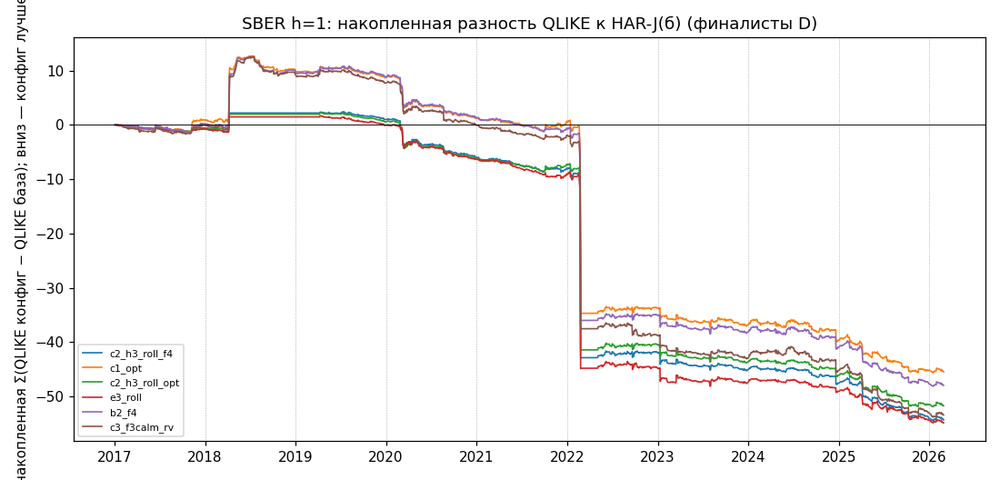
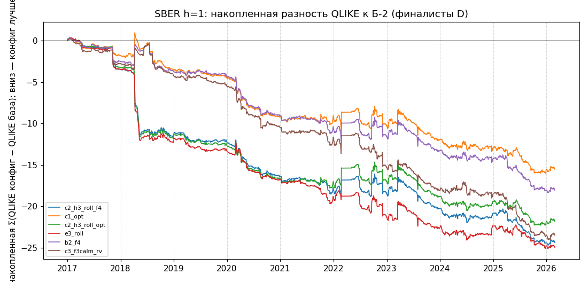

# SBER h=1: глубокая доработка бустинга (Ж-204) — итоговый отчёт

Статус: разработка, до аудита; оценка 2017–02.2026 (2022+ — просмотр контроля гл. 3 по SBER), **не независимый OOS**; первая цифра — потолок (подбор и счёт на одних датах); множественный поиск: N = 106 уникальных trials программы (справочно 116 с контролями). Числа — из csv этой папки.

## 0. Итог
(а) По GATES_D (порога «убедительно» там нет): тройка и флаги как есть; лучшая устойчивая по порядку D3 — `c2_h3_roll_f4` (QLIKE 0,2098 против 0,2205 у Б-2). p Холма (N=106) к Б-2 [DM / бутстрап]: `c2_h3_roll_f4` 0,045 / 0,042; `c1_opt` 1,000 / 0,364; `c2_h3_roll_opt` 0,287 / 0,103. (б) ↺ порог введён агентом ПОСЛЕ просмотра результатов D2 (не объявлен в GATES_D); показан справочно: p Холма (N=106) < 0,05 к Б-2 по DM и бутстрапу — проходят `c2_h3_roll_f4` 0,045 / 0,042, `c3_f3calm_rv` 0,026 / 0,021 (потолок: выбор на оценочном периоде); только по бутстрапу — `e3_roll` 0,077 / 0,042. Первая строка тройки порог проходит. 

Тройка лучших устойчивых (правило D3, `GATES_D.md` §4): `c2_h3_roll_f4`, `c1_opt`, `c2_h3_roll_opt`. Допускаются строки: perspective И seed-ok И plateau-ok И MCS (p >= 0,10); строки `c3_f3calm_*` (калм-модель выбрана на оценочном периоде) показаны отдельно. Лучший ансамбль D1 по `Q_wf`: `e3_roll`; по `Q_wf_dev` (разработка 2017–2020): `e6_rv`.

**Что установлено (числа — из таблиц ниже и `ENSEMBLE_RESULTS.csv`, `STATISTICAL_TESTS.csv`, `FINAL_RANKING.csv`).**
1. Убедительного, устойчивого к поправке улучшения над Б-2 нет. Три строки тройки (`c2_h3_roll_f4`, `c1_opt`, `c2_h3_roll_opt`) лучше Б-2 по QLIKE (0,2098 / 0,2136 / 0,2109 против 0,2205), все seed-ok, plateau-ok, и MCS (90 %) оставляет в множестве **все 8 моделей, включая HAR-J(б) и Б-2** (p_MCS = 0,19 на всём периоде): различие между лучшими конфигурациями, HAR-J(б) и Б-2 на всём периоде MCS-ом не разделяется. Справочный порог p < 0,05 (↺ введён агентом ПОСЛЕ просмотра D2, в GATES_D его нет) к Б-2 после Холма (N = 106): по DM и бутстрапу проходит `c2_h3_roll_f4` (0,045 / 0,042); `e3_roll` — только по бутстрапу (DM 0,077 / бутстрап 0,042); `c1_opt` — 1,000 / 0,364; `c2_h3_roll_opt` — 0,287 / 0,103. `e3_roll` (лучший ансамбль D1 по `Q_wf`, QLIKE 0,2095) в тройку не вошёл: plateau-ok «не проверено» (нет XGB-членов; соседи HP для LGBM не считались) — до исправления проверка на пустом множестве давала «ok». К HAR-J(б) на всём периоде DM-p Холма = 1,000 у всех финалистов (в 2022 г. QLIKE HAR-J(б) 0,6483 против 0,4755…0,4876 у финалистов); «без 24.02.2022» сырые p к HAR-J(б) 0,003–0,22, Холм 0,28–1,00.
2. **Вывод: Б-2 остаётся действующим контролем** (MCS не разделяет; порог «убедительно» — справочный, см. выше, чтения (а) и (б)). Кандидаты на независимую проверку (не на масштабирование как факт): `c2_h3_roll_f4` (смесь HAR-J(б) и `b2_f4`, веса по последним 252 закрытым прогнозам; единственная из тройки, проходящая справочный порог) и `e3_roll` (HAR-J(б) + LightGBM на тех же признаках, тот же roll-вес; QLIKE на 0,0003 ниже, статистически неотличим). Общий вид — «HAR-J(б) + бустинг F4, веса по недавним закрытым ошибкам»: он выигрывает у Б-2 в 9 годах из 10 и у `b2_f4` в 2017–2021, но в 2022–2026 не лучше одиночного `b2_f4` (`e3_roll` 0,2864; `b2_f4` 0,2849; Б-2 0,2925). Решение о масштабировании на другие тикеры — класс A (владелец).
3. Что даёт каждый шаг: F4 к Б-2 — 0,2205 → 0,2125 (9 лет из 10; seed-ok, plateau-ok); Optuna не улучшила (0,2136); LightGBM на тех же признаках 0,2117 против 0,2125 XGB (D1, `d_lgbm_f4`), смесь XGB+LGBM `e1_*` 0,2122–0,2124 (не лучше простого среднего 0,2114); окна: rolling 1008 хуже expanding на 0,0097–0,0124 у всех финалистов (`D_WINDOW.csv`), веса «2 года» 0,2178 против 0,2125 — укороченная история вредит; режимный ансамбль `e6_*` 0,2153 и inverse-ошибки `e7_*` 0,2114–0,2150 не лучше roll-смесей.
4. **Честная половина.** Выбор лучшего ансамбля по `Q_wf` (`e3_roll`) сделан среди 13 на оценочном периоде — потолок. Выбор по разработке (`Q_wf_dev`, цели 2017–2020) — `e6_rv`; его QLIKE 2022–2026 равен 0,2982 — хуже Б-2 (0,2925): выбор по разработке преимущество в 2022–2026 не подтверждает. `c3_f3calm_rv/g4` (лучшие на 2022–2026: 0,2807; DM-p Холма к Б-2 у `c3_f3calm_rv` 0,026) в тройку не входят: калм-модель `b2_top2` выбрана на оценочном периоде.
5. Экстремальные дни: топ-20 дней дают 31–36 % Σ|Δ| к HAR-J(б); без них среднее Δ остаётся отрицательным у всех финалистов; знак Δ при исключении любого года сохраняется (10 из 10) — выигрыш не держится на одном годе. Нижний дециль RV по прошлому (n = 393): финалисты лучше Б-2 на 0,0096…0,0118 (раздел 7). Уровни блока §27: A — выполнен (без look-ahead, воспроизводимо); B — выполнен; C — выполнен (улучшение без деградации 2017–2021 у смесей); D — **частично**: к Б-2 справочный порог проходит одна из трёх строк тройки (граница значимости, потолок), к HAR-J(б) после Холма — ни одна; E — не оценивался (стратегии не пересчитывались).

## 1. Таблица 1. Рейтинг (RMSE/MAE/R² — по логарифмам: ln RV − ln σ̂²; R² — регрессия Минцера–Заронвица в логарифмах)
| Модель | QLIKE | RMSE (ln) | MAE (ln) | R² MZ (ln) | DM p к Б-2 (сырой) | Статус |
|---|---|---|---|---|---|---|
| Б-2 | 0,2205 | 0,6313 | 0,4933 | 0,586 | — | контроль (база, действующий) |
| HAR-J(б) | 0,2337 | 0,6249 | 0,4874 | 0,594 | — | контроль (база) |
| e3_roll | 0,2095 | 0,6103 | 0,4743 | 0,611 | 0,0007 | не допущен: plateau_ok |
| c2_h3_roll_f4 | 0,2098 | 0,6089 | 0,4721 | 0,612 | 0,0004 | тройка №1 |
| c1_opt | 0,2136 | 0,6104 | 0,4727 | 0,606 | 0,0120 | тройка №2 |
| c2_h3_roll_opt | 0,2109 | 0,6095 | 0,4729 | 0,610 | 0,0028 | тройка №3 |
| b2_f4 | 0,2125 | 0,6106 | 0,4730 | 0,608 | 0,0038 | допущен по флагам, вне тройки (порядок D3) |
| c3_f3calm_g4 | 0,2103 | 0,6081 | 0,4717 | 0,611 | — | отдельно: выбор на оценочном периоде (потолок) |
| c3_f3calm_rv | 0,2101 | 0,6077 | 0,4711 | 0,611 | 0,0002 | отдельно: выбор на оценочном периоде (потолок) |

## 2. Таблица 2. Качество по периодам (QLIKE)
| Модель | 2017–2021 | 2022 | 2023–2025 | 2026 | Вся история |
|---|---|---|---|---|---|
| Б-2 | 0,1630 | 0,4877 | 0,2432 | 0,2188 | 0,2205 |
| HAR-J(б) | 0,1553 | 0,6483 | 0,2513 | 0,2268 | 0,2337 |
| e3_roll | 0,1482 | 0,4755 | 0,2387 | 0,2138 | 0,2095 |
| c2_h3_roll_f4 | 0,1490 | 0,4842 | 0,2354 | 0,2189 | 0,2098 |
| c1_opt | 0,1559 | 0,4818 | 0,2363 | 0,2189 | 0,2136 |
| c2_h3_roll_opt | 0,1496 | 0,4876 | 0,2369 | 0,2189 | 0,2109 |
| b2_f4 | 0,1548 | 0,4818 | 0,2347 | 0,2189 | 0,2125 |
| c3_f3calm_g4 | 0,1542 | 0,4698 | 0,2325 | 0,2177 | 0,2103 |
| c3_f3calm_rv | 0,1538 | 0,4699 | 0,2325 | 0,2177 | 0,2101 |

## 3. Таблица 3. Вклад улучшений
| Изменение | QLIKE до | QLIKE после | Выигрыш | Устойчивость |
|---|---|---|---|---|
| HAR-J(б) → Б-2 | 0,2337 | 0,2205 | 0,0132 | лет лучше: 8 из 10; MCS p=0,19;  |
| Б-2 → Б-2 + F4 (`b2_f4`) | 0,2205 | 0,2125 | 0,0079 | лет лучше: 9 из 10; MCS p=0,19; seed-ok True, plateau-ok ok |
| `b2_f4` → Optuna HP (`c1_opt`) | 0,2125 | 0,2136 | -0,0011 | лет лучше: 2 из 10; MCS p=0,19; seed-ok True, plateau-ok ok |
| `b2_f4` → смесь с HAR-J(б) (`c2_h3_roll_f4`) | 0,2125 | 0,2098 | 0,0028 | лет лучше: 5 из 10; MCS p=0,19; seed-ok True, plateau-ok ok |
| `b2_f4` → лучший ансамбль D1 (`e3_roll`) | 0,2125 | 0,2095 | 0,0030 | лет лучше: 6 из 10; MCS p=0,19; seed-ok True, plateau-ok не проверено |
| `b2_f4` → F3 в спокойном режиме (`c3_f3calm_rv`, потолок) | 0,2125 | 0,2101 | 0,0024 | лет лучше: 8 из 10; MCS p=0,19; seed-ok True, plateau-ok ok |
| простое среднее (`mean_log_xl`) → лучший ансамбль | 0,2114 | 0,2095 | 0,0019 | контроль без параметров |

## 4. Таблица 4. По рыночным режимам (QLIKE; режимы PIT по 252 предыдущим, Г4 — стресс)
| Модель | Низкая RV (квинтили 0–1) (n=1044) | Средняя RV (квинтиль 2) (n=411) | Высокая RV (квинтили 3–4) (n=816) | Стресс (Г4) (n=1031) |
|---|---|---|---|---|
| HAR-J(б) | 0,1905 | 0,1714 | 0,3202 | 0,2829 |
| Б-2 | 0,1888 | 0,1709 | 0,2860 | 0,2530 |
| c2_h3_roll_f4 | 0,1834 | 0,1674 | 0,2648 | 0,2375 |
| c1_opt | 0,1847 | 0,1629 | 0,2763 | 0,2451 |
| c2_h3_roll_opt | 0,1844 | 0,1660 | 0,2674 | 0,2400 |
| e3_roll | 0,1836 | 0,1653 | 0,2648 | 0,2375 |
| b2_f4 | 0,1840 | 0,1630 | 0,2740 | 0,2428 |
| c3_f3calm_rv | 0,1797 | 0,1623 | 0,2732 | 0,2417 |

## 5. Таблица 5. Стабильность
| Модель | Годы с выигрышем | Худший год | Чувствительность к параметрам | DM к Б-2 |
|---|---|---|---|---|
| e3_roll | 9 из 10 (к Б-2); 9 из 10 (к HAR-J(б)) | 2024 (Δ к Б-2 +0,0011) | seeds: ст.откл. 0,0010, 5/5 ok; соседи: не проверено; окно 1008: +0,0124 | p=0,001; Холм N=106: 0,077 |
| c2_h3_roll_f4 | 9 из 10 (к Б-2); 9 из 10 (к HAR-J(б)) | 2026 (Δ к Б-2 +0,0000) | seeds: ст.откл. 0,0011, 5/5 ok; соседи: ok; окно 1008: +0,0118 | p=0,000; Холм N=106: 0,045 |
| c1_opt | 8 из 10 (к Б-2); 8 из 10 (к HAR-J(б)) | 2021 (Δ к Б-2 +0,0006) | seeds: ст.откл. 0,0008, 5/5 ok; соседи: ok; окно 1008: +0,0101 | p=0,012; Холм N=106: 1,000 |
| c2_h3_roll_opt | 9 из 10 (к Б-2); 9 из 10 (к HAR-J(б)) | 2026 (Δ к Б-2 +0,0000) | seeds: ст.откл. 0,0011, 5/5 ok; соседи: ok; окно 1008: +0,0108 | p=0,003; Холм N=106: 0,287 |
| b2_f4 | 9 из 10 (к Б-2); 8 из 10 (к HAR-J(б)) | 2026 (Δ к Б-2 +0,0000) | seeds: ст.откл. 0,0013, 5/5 ok; соседи: ok; окно 1008: +0,0110 | p=0,004; Холм N=106: 0,389 |
| c3_f3calm_g4 | 10 из 10 (к Б-2); 9 из 10 (к HAR-J(б)) | 2026 (Δ к Б-2 -0,0011) | seeds: ст.откл. 0,0016, 5/5 ok; соседи: ok; окно 1008: +0,0100 | не считался (справочная строка) |
| c3_f3calm_rv | 10 из 10 (к Б-2); 9 из 10 (к HAR-J(б)) | 2026 (Δ к Б-2 -0,0011) | seeds: ст.откл. 0,0017, 5/5 ok; соседи: ok; окно 1008: +0,0097 | p=0,000; Холм N=106: 0,026 |

## 6. Накопленная разность ежедневных потерь
`D_cum_vs_harj.png`, `D_cum_vs_b2.png` (данные — `D_CUMDIFF.csv`):  

## 7. Диагностики (`D_TOP20.csv`, `D_LOYO.csv`, `D_LOWRV.csv`)
| Модель | доля топ-20 в Σ\|Δ\| (к HAR-J) | среднее Δ к HAR-J без топ-20 | Δ без 2022: HAR-J / Б-2 | знак Δ сохраняется при исключении года: HAR-J / Б-2 | нижний дециль: n | QLIKE | Δ к Б-2 |
|---|---|---|---|---|---|---|---|
| c2_h3_roll_f4 | 0,362 | -0,0050 | -0,0099 / -0,0115 | 10 из 10 / 10 из 10 | 393 | 0,1793 | -0,0110 |
| c1_opt | 0,311 | -0,0041 | -0,0053 / -0,0069 | 10 из 10 / 10 из 10 | 393 | 0,1806 | -0,0098 |
| c2_h3_roll_opt | 0,354 | -0,0047 | -0,0089 / -0,0106 | 10 из 10 / 10 из 10 | 393 | 0,1807 | -0,0096 |
| e3_roll | 0,362 | -0,0059 | -0,0093 / -0,0109 | 10 из 10 / 10 из 10 | 393 | 0,1786 | -0,0118 |
| b2_f4 | 0,314 | -0,0035 | -0,0065 / -0,0082 | 10 из 10 / 10 из 10 | 393 | 0,1801 | -0,0103 |
| c3_f3calm_rv | 0,308 | -0,0040 | -0,0080 / -0,0096 | 10 из 10 / 10 из 10 | 393 | 0,1792 | -0,0112 |

## 8. Статистика и устойчивость
Полные таблицы: `STATISTICAL_TESTS.csv` (DM × 5 периодов × 2 базы, MCS, бутстрап, Холм N=106/116), `D_SEEDS.csv`, `D_PLATEAU.csv`, `D_WINDOW.csv`, `ENSEMBLE_RESULTS.csv`, `FINAL_RANKING.csv`, `MODEL_SPECIFICATIONS.json`. Счётчики trials: ensemble_calibration 16; feature_engineering 37; har_boosting 20; objectives_target 8; regime_aware 15; rolling_recency 10 (всего 106 из 240); D = 16 из 25.

## 9. Оговорки
1. 2017–02.2026 уже многократно просматривалось: это проверка исторической устойчивости, не новый OOS. 2. Лучший ансамбль выбран среди 13 по `Q_wf` на оценочном периоде — его 2017–2026 потолок; честная половина — выбор по `Q_wf_dev` и его результат на 2022–2026. 3. Для LGBM соседи HP не считались (HP наследуются от XGB-И2); охват — seeds. 4. Порог «убедительно» (p < 0,05 по DM и бутстрапу после Холма, к первой строке тройки) — ↺ введён агентом ПОСЛЕ просмотра результатов D2 (не объявлен в GATES_D); показан справочно, рядом с чтением по GATES_D без порога. Plateau-ok у ансамбля без XGB-членов (`e3_roll`: HAR + LGBM) — «не проверено» (соседи HP для LGBM не считались), в тройку такая строка не допускается. 5. Холм: семейства по 6 финалистов, недостающие до N — p = 1; подпериодные p сырые. 6. Торговые стратегии не пересчитывались.
